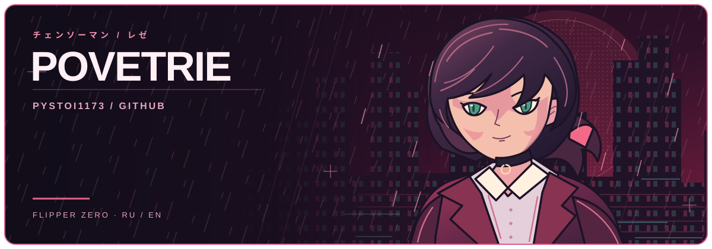

  

# Povetrie

Локализую интерфейсы и пишу гайды по установке и настройке. Сейчас работаю над русско-английской прошивкой для Flipper Zero.

## Проекты

### Unleashed RU/EN · Flipper Zero

Русский по умолчанию, переключение на English, кириллица в стандартных шрифтах и встроенное руководство из 12 тем. Перевод пока частичный. Установочный пакет alpha.1 проверен на устройстве через qFlipper.

| Хочу | Куда идти |
| --- | --- |
| Скачать прошивку | [Релиз alpha.1](https://github.com/Pystoi1173/unleashed-ru/releases/tag/ru-en-2026.11.18-alpha.1) |
| Сделать резервную копию и установить | [Пошаговая инструкция](https://github.com/Pystoi1173/unleashed-ru/blob/main/INSTALL_RU.md) |
| Разобраться в меню и приложениях | [Справочник по Flipper Zero](https://github.com/Pystoi1173/unleashed-ru/blob/main/USER_GUIDE_RU.md) |
| Посмотреть исходники | [Репозиторий Unleashed RU/EN](https://github.com/Pystoi1173/unleashed-ru) |

Пробовали alpha.1? Напишите, какие экраны стоит перевести следующими и что оказалось непонятно при установке. [Обсуждения проекта](https://github.com/Pystoi1173/unleashed-ru/discussions) · [Сообщить об ошибке](https://github.com/Pystoi1173/unleashed-ru/issues)

---

Баннер с фан-артом Резе сделан для этого профиля. Персонаж из манги Chainsaw Man Тацуки Фудзимото.
